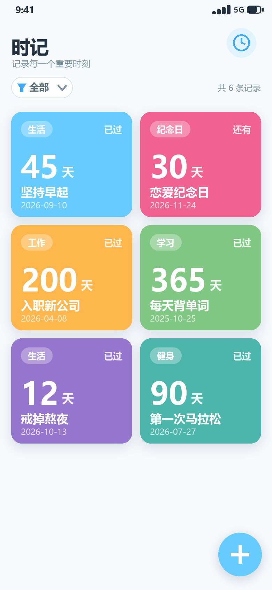

# 终末时记（EndField Time）

> 记录每一个重要时刻 —— Android 里程碑时间记录应用 · 设计文档包

「终末时记」是一款**纯本地**的 Android 应用：以彩色卡片记录里程碑（分类、内容、目标日期、可选内容详情），实时展示该日期距今天的天数（已过 N 天 / 还有 N 天）。半平面风设计，主色 `#66CCFF`，无需登录，数据仅存储在本机。



## 功能概览

| 功能 | 说明 |
| --- | --- |
| 新增里程碑 | 底部「＋」进入，填写内容 / 分类 / 目标日期 / 卡片颜色 / 内容详情（选填），附实时预览 |
| 分类下拉搜索 | 分类采用**下拉选择 + 模糊搜索**，命中高亮、搜索词一键新建分类，分类再多也无需左右滑动 |
| 内容详情 | 每条里程碑可附 ≤1000 字详情；卡片上不展示，详情页内点击【查看内容详情】弹层阅读全文 |
| 卡片详情页 | 单击卡片进入：通栏大卡片 + 完整信息（分类/日期/天数状态/详情字数/创建时间） |
| 编辑里程碑 | 详情页点【编辑】或右上角铅笔进入，表单回填现有数据，保存走 UPDATE |
| 卡片列表 | 两列彩色方块卡片，展示分类、天数大数字、内容与日期，颜色可自定义 |
| 天数计算 | 自动展示"已过 N 天 / 还有 N 天 / 就是今天"，回到前台自动重算 |
| 分类过滤（搜索模式） | 顶部筛选按钮只显示当前生效标签；点按弹搜索面板选择分类，✕ / 置顶「全部」一键重置，记住上次选择 |
| 长按删除 | 长按卡片 → 删除菜单 → 二次确认 → 删除并自动刷新 |
| 本地存储 | Room(SQLite) 持久化，100% 离线可用，不申请网络权限 |
| 数据备份迁移 | 右上角「⋮」导出为紧凑 JSON（可选 gzip）或导入还原；换设备时「合并」去重、「覆盖」清空重建，实测 2 条记录仅 302 B |
| 桌面小组件 | 单条里程碑大卡（4×2，可缩放）：桌面直接看天数，点按打开应用；添加时选绑定哪一条，增删改即时刷新 |

## 开发状态：已实现并跑通（可运行）

应用源码位于 [`android/`](android)，已在本机编译通过并在 Android 16（API 36）模拟器上实测全部功能：


- 构建：`AGP 9.4.1 + Gradle 9.8.2 + 内置 Kotlin + KSP(Room) + compileSdk 36 / minSdk 26`
- 产物：`android/app/build/outputs/apk/debug/app-debug.apk`（约 12.8 MB，包名 `com.endfield.time`）
- 已实测：新增（含分类下拉搜索）→ 列表 → 单击进详情 → 编辑回填保存 → 内容详情弹层 → 长按删除 → 确认删除
- 构建与联调细节、两个真实缺陷的修复记录见 [06 · 开发与构建说明](docs/06-开发与构建说明.md)

```powershell
$env:JAVA_HOME = 'D:\Program Files\Android\Android Studio\jbr'
cd android
.\gradlew assembleDebug        # 编译
.\gradlew testDebugUnitTest    # 单元测试（4 例）
```

## 设计文档索引

| 文档 | 内容 |
| --- | --- |
| [01 · 界面原型图](docs/01-界面原型图.md) | 10 个界面状态原型 + 视觉规范（主界面 / 过滤 / 新增 / 分类下拉 / 编辑 / 卡片详情 / 内容详情 / 长按菜单 / 删除确认） |
| [02 · 技术选型文档](docs/02-技术选型文档.md) | Kotlin + Compose + MVVM + Room 选型论证、对比表、依赖配置、主题规范 |
| [03 · 功能流程图](docs/03-功能流程图.md) | 启动加载主流程 + 过滤 / 新增 / 查看详情 / 删除四大分支 + 卡片详情子流程图 |
| [04 · 时序图](docs/04-时序图.md) | ①启动加载与分类过滤 ②新增与长按删除 ③卡片详情/查看内容详情/编辑，共 75 条消息说明 |
| [05 · 功能设计文档](docs/05-功能设计文档.md) | 需求列表、数据模型、业务规则、界面设计、**关键流程伪代码**、异常处理 |
| [06 · 开发与构建说明](docs/06-开发与构建说明.md) | 工程结构、构建环境、AGP 9 迁移要点、实机验证截图、缺陷修复记录 |
| [07 · 数据导入导出设计](docs/07-数据导入导出设计.md) | 导出格式 v1 规范、格式选型对比、**体积实测**、空间优化清单、导入冲突策略、安全边界 |
| [08 · 桌面小组件设计](docs/08-桌面小组件设计.md) | 小组件形态与交互、数据绑定、刷新策略、RemoteViews 选型与踩坑、实测记录 |

## 技术栈速览

**设计目标**：Kotlin · Compose (Material 3) · MVVM + 单向数据流 · Room · DataStore · Coroutines/Flow · Hilt

**实际落地**：Kotlin（AGP 9 内置）· Compose (Material 3) · MVVM + UDF · Room + KSP · DataStore · Flow ·
手动 DI（替代 Hilt，设计文档 §7 允许）· AGP 9.4.1 / Gradle 9.8.2 / minSdk 26 / targetSdk 36

## 目录结构

```
EndFieldTime/
├── README.md                    # 本文件
├── android/                     # ★ Android 工程（可编译运行）
│   ├── gradlew / gradlew.bat / gradle/     # Gradle Wrapper 9.8.2
│   ├── build.gradle.kts / settings.gradle.kts / gradle.properties
│   └── app/                                # 应用模块
│       ├── build.gradle.kts
│       └── src/main/java/com/endfield/time/  # 应用源码(22 个 Kotlin 文件)
├── docs/
│   ├── 01-界面原型图.md
│   ├── 02-技术选型文档.md
│   ├── 03-功能流程图.md
│   ├── 04-时序图.md
│   ├── 05-功能设计文档.md
│   ├── 06-开发与构建说明.md
│   ├── 07-数据导入导出设计.md
│   ├── 08-桌面小组件设计.md
│   └── images/                  # 原型图、图表、实机截图(PNG)
│       ├── app-01-home.png            # 实机：主界面
│       ├── app-03-detail.png          # 实机：卡片详情
│       ├── app-04-content.png         # 实机：内容详情弹层
│       ├── app-05-longpress.png       # 实机：长按菜单
│       ├── app-06-delete-confirm.png  # 实机：删除确认
│       ├── app-07-category.png        # 实机：分类下拉搜索
│       ├── app-08-filter.png          # 实机：首页筛选面板
│       ├── app-09-export-menu.png     # 实机：导出/导入菜单
│       ├── app-10-import-dialog.png   # 实机：导入确认
│       ├── app-11-imported.png        # 实机：导入结果
│       ├── app-12-upgrade-kept-data.png # 实机：覆盖升级后数据保留
│       ├── app-13-widget-preview.png  # 实机：小组件选择器预览
│       ├── app-14-widget-home.png     # 实机：桌面小组件
│       ├── widget-preview.png         # 小组件形态示意(设计稿)
│       ├── proto-01-home.png            # 主界面
│       ├── proto-02-filter.png          # 分类过滤
│       ├── proto-03-add.png             # 新增里程碑(下拉分类 + 内容详情)
│       ├── proto-04-longpress.png       # 长按删除菜单
│       ├── proto-05-delete.png          # 删除确认对话框
│       ├── proto-06-card-detail.png     # 卡片详情页
│       ├── proto-07-content-detail.png  # 内容详情页(底部弹层)
│       ├── proto-08-category.png        # 分类下拉选择(模糊搜索)
│       ├── proto-09-edit.png            # 编辑里程碑
│       ├── proto-10-home-filter.png     # 首页筛选面板(搜索选择)
│       ├── flowchart.png                # 功能流程图(主)
│       ├── flowchart-02-detail.png      # 卡片详情子流程图
│       ├── seq-01-load-filter.png       # 时序图①
│       ├── seq-02-add-delete.png        # 时序图②
│       └── seq-03-detail-edit.png       # 时序图③
```
