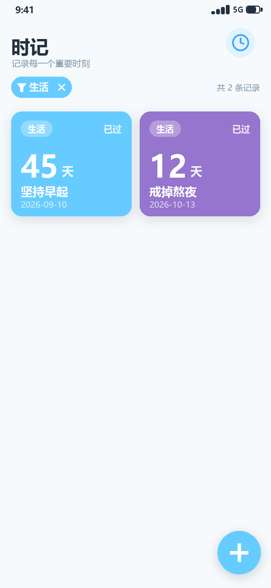
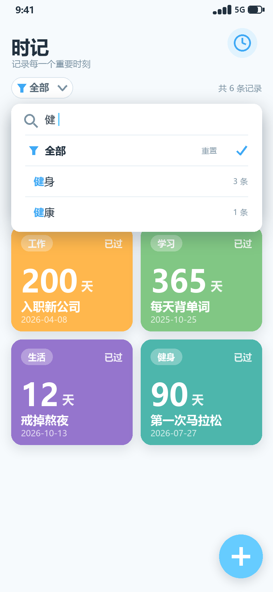
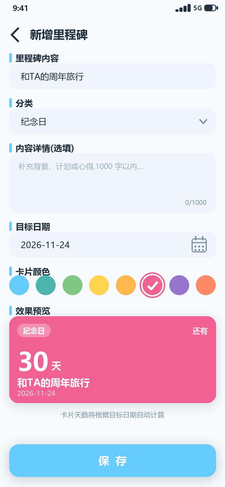
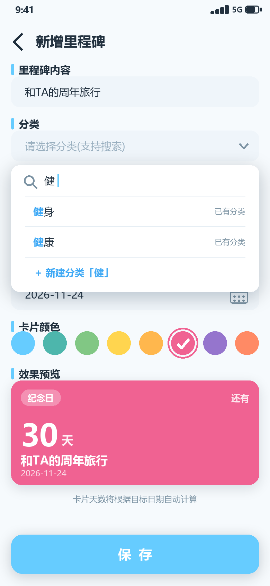
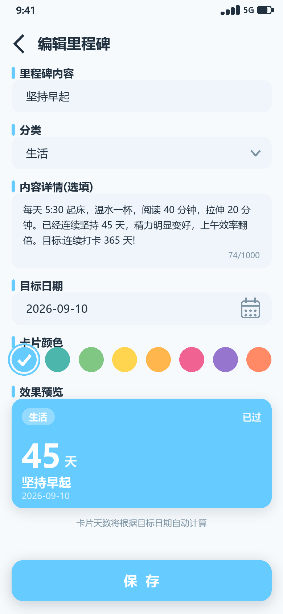
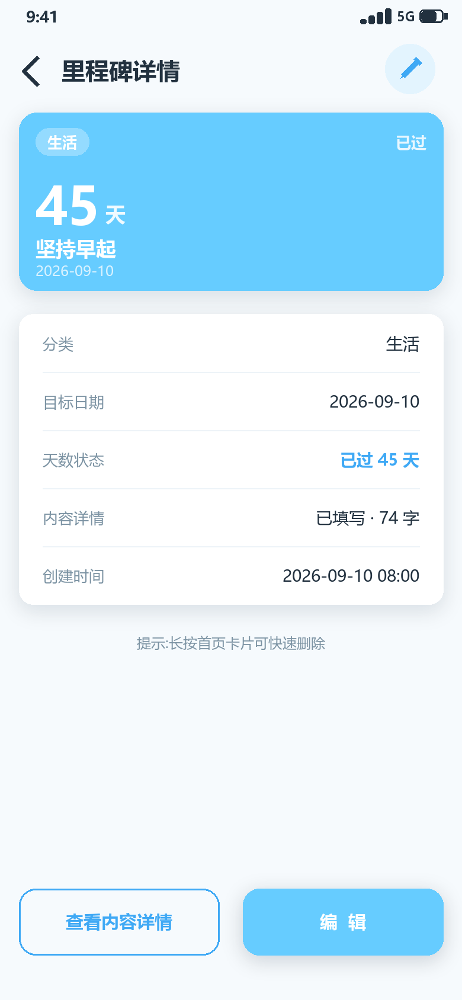
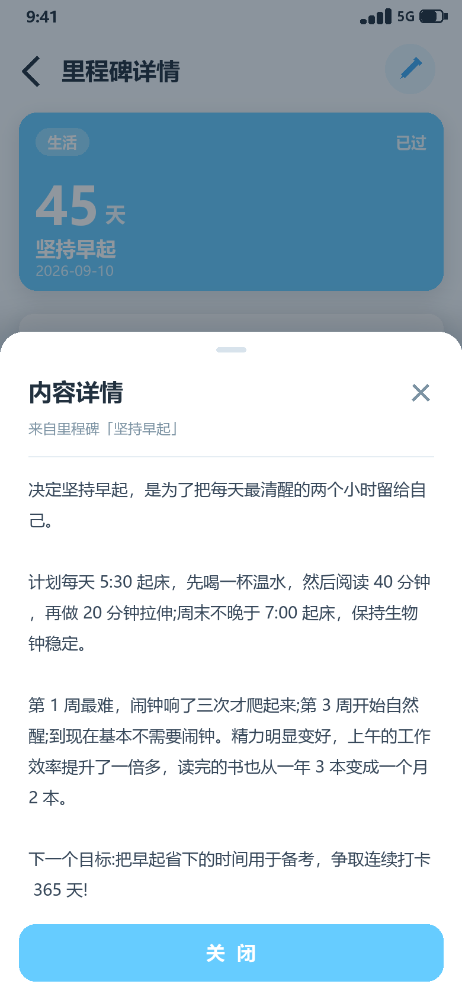
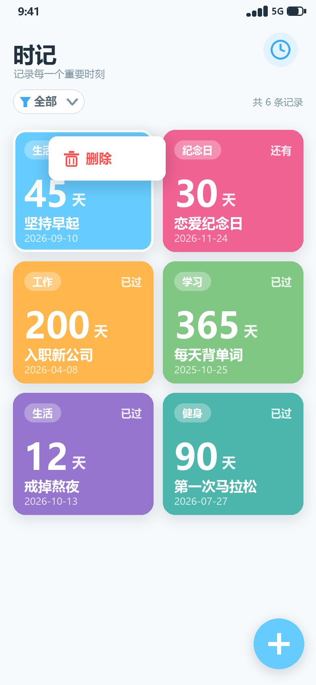
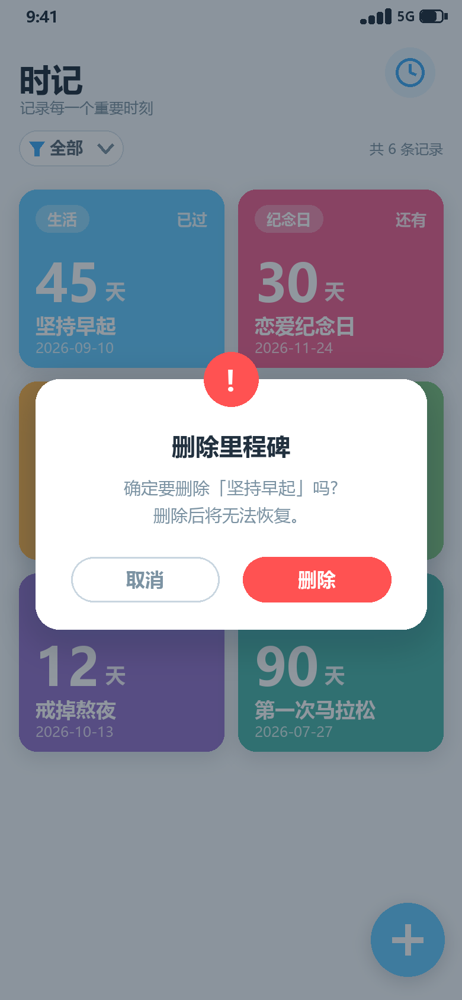

# 时记 · 界面原型图

> 风格：半平面风（Semi-flat）——纯色块 + 大圆角 + 轻投影；主色 `#66CCFF`。
> 原型按 390×844 dp（2 倍图）绘制，共 10 个界面状态。

## 页面导航结构

```
主界面(列表)
 ├── 筛选按钮 ──→ 筛选面板(搜索选择,「全部」可重置)
 ├── 单击卡片 ──→ 卡片详情页 ──→ 查看内容详情 ──→ 内容详情页(底部弹层)
 │                 └── 编辑 ──→ 编辑里程碑页
 ├── 长按卡片 ──→ 删除菜单 → 删除确认对话框
 └── ＋ ──→ 新增里程碑页 ──→ 分类下拉选择(模糊搜索)
```

## 1. 主界面


| 区域 | 说明 |
| --- | --- |
| 标题栏 | 「时记」+ 副标题"记录每一个重要时刻"，右侧时钟装饰图标 |
| 筛选栏 | 左侧**筛选按钮**（漏斗图标 + 当前生效标签「全部」+ 下拉箭头，描边态），右侧记录数"共 6 条记录"。**平时只显示当前生效的这一个标签**，不再平铺全部分类 |
| 里程碑卡片 | 两列网格。每张卡片包含：左上**分类 Chip**（白 30% 透明底）、右上**已过/还有**标签、中部**天数大数字 + 天**、底部**内容标题**与**目标日期**；背景为用户自定义颜色，圆角 15dp，轻投影。**单击进入卡片详情页**，长按弹出删除菜单 |
| 悬浮按钮 | 右下角圆形「＋」，主色 `#66CCFF`，点击进入新增页 |

天数示例：过去日期显示"已过 45 天"，未来日期显示"还有 30 天"，当天显示"就是今天"。内容详情（≤1000 字）**不在卡片上展示**，需进入详情页查看。

## 2. 分类过滤（生效态）



- 通过筛选面板选中分类（图中「生活」）后，卡片区仅展示该分类的记录；
- 筛选按钮变为**实心主色标签**：漏斗 + 「生活」+ **✕**，右侧记录数同步为"共 2 条记录"；
- 点击 ✕（或在面板中选择「全部」）即**重置为全部**；选中状态会记忆，下次启动自动恢复。

## 3. 筛选面板（搜索选择）



点击筛选按钮展开面板，与新增/编辑表单的分类面板**同一组件**，差异仅两处：顶部固定「全部（重置）」行、不提供新建分类入口。

| 区块 | 说明 |
| --- | --- |
| 搜索行 | 面板顶部搜索框，输入即实时过滤，无需点搜索按钮 |
| 全部（置顶） | 漏斗图标 +「全部」，右侧标注"重置"；**当前生效项右侧显示对勾**（图中当前为全部） |
| 匹配分类 | 命中字符主色高亮（如输入"健"命中 健身 / 健康），右侧显示该分类下记录数 |
| 空结果 | 搜索无匹配时显示"无匹配分类"提示（不提供新建入口，新建分类仅在表单侧） |
| 关闭 | 点选分类即应用过滤并收起；点击面板外区域直接收起，不做变更 |

## 4. 新增里程碑



| 区块 | 说明 |
| --- | --- |
| 里程碑内容 | 单行输入框，必填，≤ 50 字 |
| 分类 | **下拉选择框**（右侧下拉箭头），点击展开分类面板，支持模糊搜索，见第 5 节 |
| 内容详情（选填） | 多行输入框，**≤ 1000 字**，右下角实时字数统计（0/1000）；选填，用于记录背景、计划或心得 |
| 目标日期 | 日期选择框，点击唤起系统 DatePicker，默认今天 |
| 卡片颜色 | 8 个预设色圆形色板单选，选中态外圈描边 + 白色对勾 |
| 效果预览 | 按当前输入**实时渲染**一张卡片（含天数自动计算） |
| 保存 | 底部通栏主色按钮；校验失败 Toast 提示，成功后返回主界面并自动刷新 |

## 5. 分类下拉选择（模糊搜索）



为应对**分类过多**的场景（横向 Chip 左右滑动寻找费时），分类选择改为下拉面板 + 模糊搜索：

| 区块 | 说明 |
| --- | --- |
| 搜索行 | 面板顶部搜索框（放大镜图标 + 光标），输入即实时过滤 |
| 匹配结果 | 已有分类列表，**命中字符主色高亮**（如输入"健"命中 健身 / 健康），右侧标注"已有分类" |
| 新建分类 | 列表底部固定「＋ 新建分类「健」」，将搜索词直接作为新分类名创建（1~10 字） |
| 关闭 | 点击面板外区域或选中某分类后自动收起，选中值回填到分类框 |

## 6. 编辑里程碑



- 与新增页**共用同一表单**，标题为「编辑里程碑」，进入时**回填全部现有数据**（图中：内容"坚持早起"、分类"生活"、内容详情 74 字、日期、蓝色卡片）；
- 内容详情字数统计同步显示（74/1000）；
- 保存走 `UPDATE`，成功后返回卡片详情页并刷新；校验规则与新增一致。

## 7. 卡片详情页



单击主界面卡片进入：

| 区域 | 说明 |
| --- | --- |
| 顶部 | 返回箭头 + 「里程碑详情」标题 + 右上角**编辑快捷入口**（铅笔图标按钮） |
| 大卡片 | 通栏渲染该里程碑卡片（同列表卡片样式，等比放大） |
| 信息面板 | 白色圆角面板，逐行展示：分类 / 目标日期 / **天数状态**（主色加粗强调）/ 内容详情（已填写 · N 字 或 未填写）/ 创建时间 |
| 底部按钮 | 【查看内容详情】描边按钮（详情为空时置灰禁用）+【编辑】主色实心按钮 |

## 8. 内容详情页（底部弹层）



- 在卡片详情页点击【查看内容详情】后，以**底部弹层（Bottom Sheet）**形式弹出，背景压暗遮罩；
- 顶部拖动条 + 「内容详情」标题 + 右上 ✕ 关闭；副标题标注来源（"来自里程碑「坚持早起」"）；
- 正文区**可滚动展示全文**（≤ 1000 字），支持下滑手势或点击【关闭】按钮收起，返回卡片详情页。

## 9. 长按删除菜单



- 长按任意卡片，卡片显示白色高亮描边，并在其上方弹出小菜单（删除，红色文案 + 垃圾桶图标）；
- 点击菜单外部区域关闭菜单，不做任何操作。

## 10. 删除确认对话框



- 背景压暗遮罩，居中白色圆角对话框，顶部红色警示图标压住上边缘；
- 文案："确定要删除「坚持早起」吗？删除后将无法恢复。"；
- 【取消】关闭对话框；【删除】执行删除，Toast「已删除」，列表由数据流自动刷新。

## 11. 视觉规范速查

| 项 | 取值 |
| --- | --- |
| 主色 / 深色 / 浅底 | `#66CCFF` / `#3FA9F5` / `#E3F4FE` |
| 页面背景 / 输入框底 | `#F6FAFD` / `#EFF5FA` |
| 主文案 / 次文案 | `#22313F` / `#7C93A3` |
| 占位提示文案 | `#9AB0C0` |
| 危险色 | `#FF5252` |
| 圆角 | 卡片 15dp、Chip/筛选按钮 全圆角、对话框 20dp、按钮 16dp、输入框 12dp、弹层顶部 20dp |
| 投影 | elevation 2~4dp，低透明度小偏移（半平面）；筛选/分类面板、弹层 8dp |
| 卡片预设色 | 蓝 `#66CCFF`、青 `#4DB6AC`、绿 `#81C784`、黄 `#FFD54F`、橙 `#FFB74D`、粉 `#F06292`、紫 `#9575CD`、橙红 `#FF8A65` |
| 卡片上文字 | 一律白色；次级信息用白色 75%~90% 透明度 |
