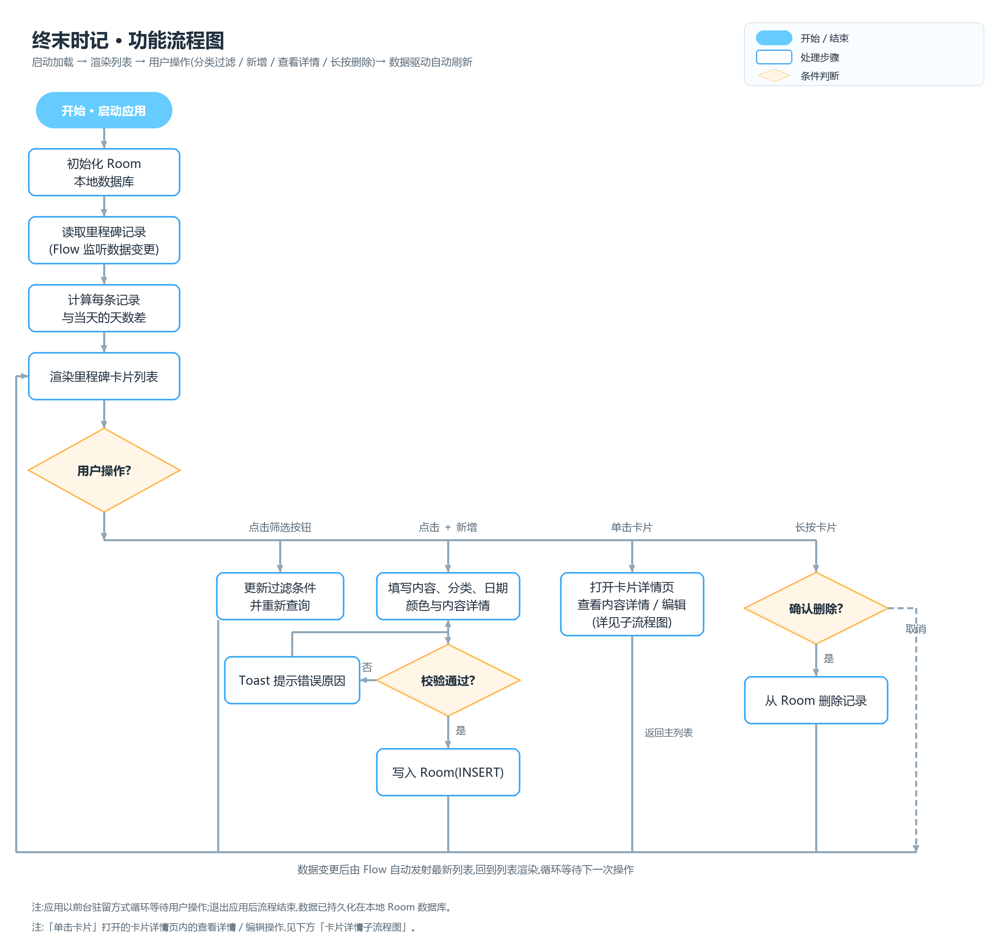
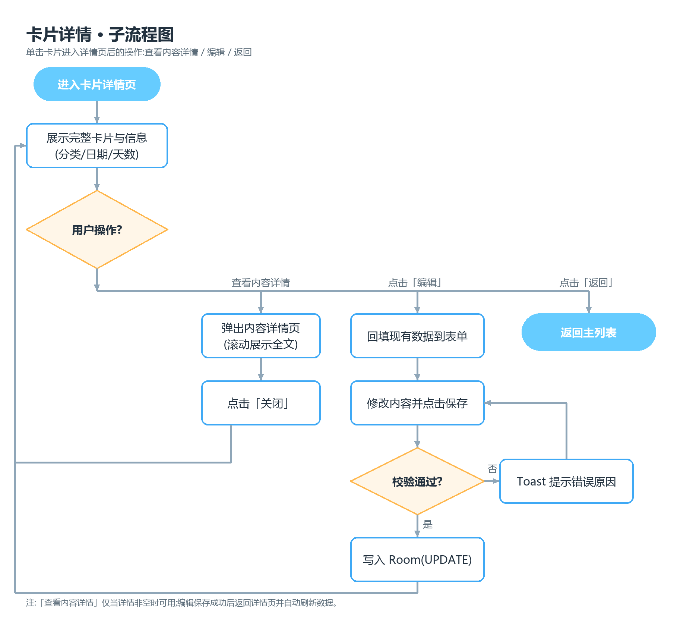

# 终末时记 · 功能流程图

## 主流程说明

| 步骤 | 说明 |
| --- | --- |
| 1. 开始 · 启动应用 | 用户点击图标冷启动 |
| 2. 初始化 Room 本地数据库 | 创建/打开 `milestone.db`，无需网络与账号 |
| 3. 读取里程碑记录 | 通过 DAO 订阅 `Flow<List<Milestone>>`，此后数据任何变更都会自动推送 |
| 4. 计算天数差 | 逐条用 `目标日期 − 今天` 得出"已过 N 天 / 还有 N 天 / 就是今天" |
| 5. 渲染卡片列表 | 按当前过滤分类渲染两列彩色卡片，随后进入等待用户操作状态 |
| 6. 退出应用 | 流程结束，数据已持久化在本地数据库 |

## 用户操作分支（4 条）

### 分支一：分类过滤（搜索模式）
点击顶部**筛选按钮**（漏斗 + 当前生效标签）→ 展开筛选面板，搜索并点选分类（置顶「全部」可重置，标签上的 ✕ 同效）→ 更新过滤条件并重新查询（"全部"不加 WHERE 条件）→ 数据流推送新列表 → 回到步骤 5 重新渲染。

### 分支二：新增里程碑
点击右下角「＋」→ 填写内容、分类（**下拉 + 模糊搜索**）、目标日期、颜色与**内容详情（选填，≤1000 字）** → **校验**：内容非空且 ≤ 50 字、分类 1~10 字、日期合法、颜色来自预设色板、详情 ≤ 1000 字 → 校验不通过则 Toast 提示错误原因并返回继续填写 → 校验通过则写入 Room（INSERT）→ 数据流自动推送新列表 → 回到步骤 5。

### 分支三：单击卡片 → 卡片详情页
单击卡片 → 打开卡片详情页（查看完整卡片与信息），页内可【查看内容详情】【编辑】【返回】，详见下方**卡片详情子流程图**；操作完成或返回后回到主列表。

### 分支四：长按删除
长按卡片 → 弹出删除菜单 → 点击「删除」弹出确认框 → 取消则回到步骤 5 无任何变更；确认则从 Room 删除记录 → 数据流自动推送新列表 → 回到步骤 5，并 Toast「已删除」。

## 卡片详情子流程图

| 步骤 | 说明 |
| --- | --- |
| 1. 进入卡片详情页 | 主界面单击卡片触发 |
| 2. 展示完整卡片与信息 | 通栏大卡片 + 信息面板（分类 / 目标日期 / 天数状态 / 内容详情字数 / 创建时间） |
| 3a. 查看内容详情 | 弹出底部弹层，滚动展示 ≤1000 字全文（详情为空时按钮置灰）；点击【关闭】/ 下滑收起，回到步骤 2 |
| 3b. 点击「编辑」 | 打开编辑页并**回填现有数据** → 修改后保存 → **校验**（同新增）→ 不通过 Toast 并返回继续修改 → 通过则写入 Room（UPDATE）→ 返回详情页，数据自动刷新 |
| 3c. 点击「返回」 | 回到主界面列表 |

## 关键设计点

- **数据驱动刷新**：各分支都不手动刷新列表——增、删、改、过滤最终都落到 Room，由 Room 返回的 `Flow` 自动发射最新数据驱动 UI 重组（图中底部回流线），保证"数据只有一份真相"。
- **校验前置**：新增与编辑仅在通过本地校验后才写库，避免脏数据。
- **删除二次确认**：删除不可恢复，必须经确认框，取消路径不产生任何副作用。
- **分类可检索**：首页筛选与表单分类选择**共用同一搜索面板组件**（首页面板顶部固定「全部（重置）」、无新建入口；表单面板可一键新建分类），分类过多时通过模糊搜索快速定位，避免横向滑动寻找。
