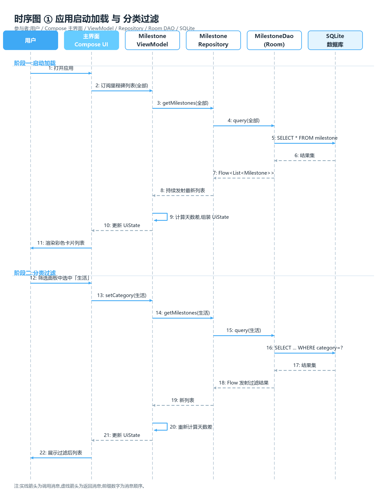
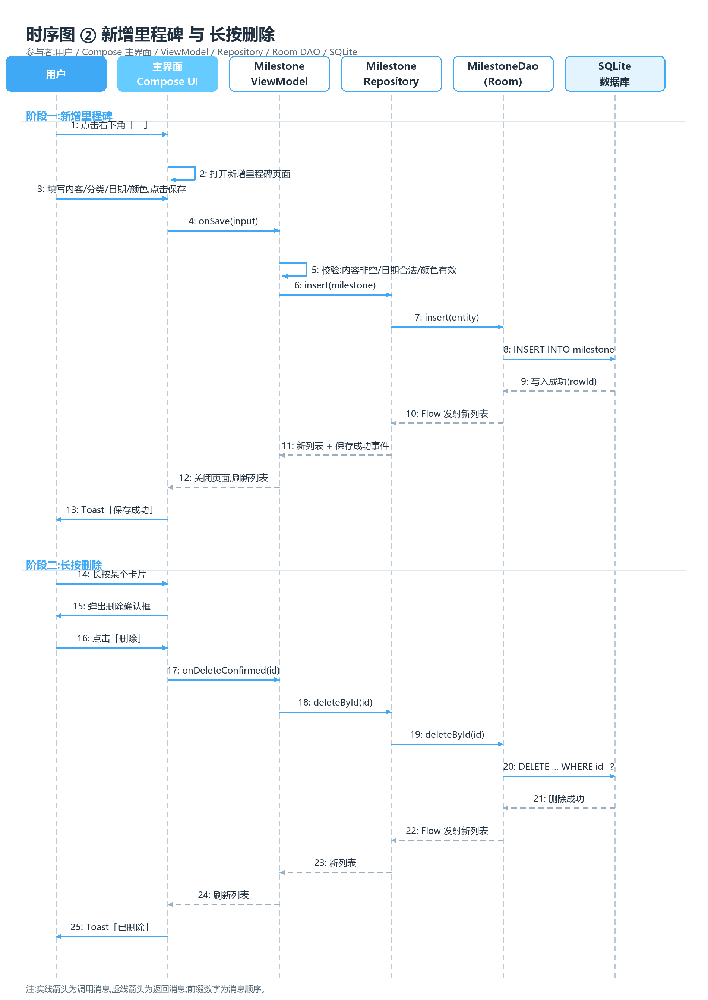
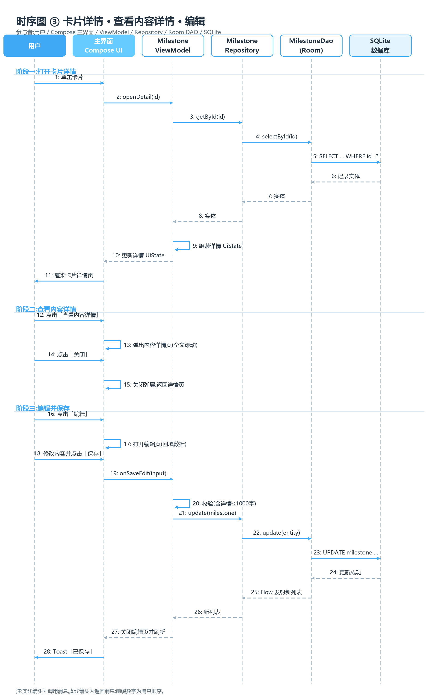

# 时记 · 时序图

> 参与者：用户、主界面（Compose UI）、MilestoneViewModel、MilestoneRepository、MilestoneDao（Room）、SQLite 数据库。
> 实线箭头 = 调用消息，虚线箭头 = 返回消息，前缀数字 = 消息顺序。

## 时序图 ① 应用启动加载 与 分类过滤

### 阶段一：启动加载

| # | 发送 → 接收 | 消息 | 说明 |
| --- | --- | --- | --- |
| 1 | 用户 → 主界面 | 打开应用 | 冷启动 MainActivity |
| 2 | 主界面 → ViewModel | 订阅里程碑列表(全部) | `collectAsStateWithLifecycle()` 订阅 UiState |
| 3 | ViewModel → Repository | getMilestones(全部) | 默认过滤为"全部"（或 DataStore 记忆的分类） |
| 4 | Repository → DAO | query(全部) | `observeAll()`，返回 Flow |
| 5 | DAO → 数据库 | SELECT * FROM milestone | 按 createdAt 倒序 |
| 6–8 | 数据库 → DAO → Repository → ViewModel | 结果集 / Flow | 逐级返回；此后数据变更会持续发射 |
| 9 | ViewModel 自身 | 计算天数差，组装 UiState | 实体 → MilestoneUi（已过/还有/今天） |
| 10 | ViewModel → 主界面 | 更新 UiState | StateFlow 发射 |
| 11 | 主界面 → 用户 | 渲染彩色卡片列表 | Compose 重组 |

### 阶段二：分类过滤

| # | 发送 → 接收 | 消息 | 说明 |
| --- | --- | --- | --- |
| 12 | 用户 → 主界面 | 点击筛选按钮，面板内搜索并选中「生活」 | 面板置顶「全部」可重置；选中即关闭面板 |
| 13 | 主界面 → ViewModel | setCategory(生活) | 同时写入 DataStore 记忆；传「全部」即重置过滤 |
| 14–17 | ViewModel → … → 数据库 | 按分类重新查询 | `SELECT ... WHERE category=?` |
| 18–21 | 数据库 → … → 主界面 | 过滤结果逐级返回 | 重新计算天数差，更新 UiState |
| 22 | 主界面 → 用户 | 展示过滤后列表 | 仅显示「生活」分类卡片 |

## 时序图 ② 新增里程碑 与 长按删除

### 阶段一：新增里程碑

| # | 发送 → 接收 | 消息 | 说明 |
| --- | --- | --- | --- |
| 1 | 用户 → 主界面 | 点击右下角「＋」 | — |
| 2 | 主界面 自身 | 打开新增里程碑页面 | 导航到 Add 页 |
| 3 | 用户 → 主界面 | 填写内容/分类(下拉搜索)/日期/颜色/详情，点击保存 | 预览卡片实时联动 |
| 4 | 主界面 → ViewModel | onSave(input) | 携带表单输入 |
| 5 | ViewModel 自身 | 校验：内容非空/日期合法/颜色有效/详情≤1000字 | 失败则 Toast 并中断（未画出分支） |
| 6–8 | ViewModel → … → 数据库 | insert | `INSERT INTO milestone` |
| 9–11 | 数据库 → … → ViewModel | 写入成功，Flow 发射新列表 | **无需手动刷新**，Room 自动推送 |
| 12 | ViewModel → 主界面 | 关闭页面，刷新列表 | 一次性事件：导航返回 |
| 13 | 主界面 → 用户 | Toast「保存成功」 | — |

### 阶段二：长按删除

| # | 发送 → 接收 | 消息 | 说明 |
| --- | --- | --- | --- |
| 14 | 用户 → 主界面 | 长按某个卡片 | `combinedClickable(onLongClick)` |
| 15 | 主界面 → 用户 | 弹出删除确认框 | 先弹删除菜单，点击后弹确认框 |
| 16 | 用户 → 主界面 | 点击「删除」 | 二次确认通过 |
| 17–20 | 主界面 → … → 数据库 | deleteById(id) | `DELETE FROM milestone WHERE id=?` |
| 21–24 | 数据库 → … → 主界面 | 删除成功，Flow 发射新列表 | 列表自动刷新，卡片消失 |
| 25 | 主界面 → 用户 | Toast「已删除」 | — |

## 时序图 ③ 卡片详情 · 查看内容详情 · 编辑

### 阶段一：打开卡片详情

| # | 发送 → 接收 | 消息 | 说明 |
| --- | --- | --- | --- |
| 1 | 用户 → 主界面 | 单击卡片 | 列表项 `combinedClickable(onClick)` |
| 2 | 主界面 → ViewModel | openDetail(id) | 携带卡片 id |
| 3–5 | ViewModel → … → 数据库 | getById / selectById | `SELECT * FROM milestone WHERE id=?` |
| 6–8 | 数据库 → … → ViewModel | 记录实体逐级返回 | — |
| 9 | ViewModel 自身 | 组装详情 UiState | 计算天数差、判断详情是否为空（决定按钮可用态） |
| 10 | ViewModel → 主界面 | 更新详情 UiState | StateFlow 发射 |
| 11 | 主界面 → 用户 | 渲染卡片详情页 | 大卡片 + 信息面板 + 底部按钮 |

### 阶段二：查看内容详情

| # | 发送 → 接收 | 消息 | 说明 |
| --- | --- | --- | --- |
| 12 | 用户 → 主界面 | 点击「查看内容详情」 | 详情非空时按钮可用 |
| 13 | 主界面 自身 | 弹出内容详情页(全文滚动) | ModalBottomSheet，纯 UI 状态，**无需查库**（数据已在 UiState 中） |
| 14 | 用户 → 主界面 | 点击「关闭」 | 或下滑手势 |
| 15 | 主界面 自身 | 关闭弹层，返回详情页 | — |

### 阶段三：编辑并保存

| # | 发送 → 接收 | 消息 | 说明 |
| --- | --- | --- | --- |
| 16 | 用户 → 主界面 | 点击「编辑」 | 底部主按钮或右上角铅笔图标 |
| 17 | 主界面 自身 | 打开编辑页(回填数据) | 与新增共用表单，标题「编辑里程碑」 |
| 18 | 用户 → 主界面 | 修改内容并点击「保存」 | — |
| 19 | 主界面 → ViewModel | onSaveEdit(input) | 携带 id + 修改后的表单 |
| 20 | ViewModel 自身 | 校验(含详情≤1000字) | 规则同新增；失败 Toast 中断（未画出分支） |
| 21–23 | ViewModel → … → 数据库 | update | `UPDATE milestone SET ... WHERE id=?` |
| 24–26 | 数据库 → … → ViewModel | 更新成功，Flow 发射新列表 | 详情页与列表数据同源，自动一致 |
| 27 | ViewModel → 主界面 | 关闭编辑页并刷新 | 一次性事件：导航返回详情页 |
| 28 | 主界面 → 用户 | Toast「已保存」 | — |

## 设计要点

- **UI 不直接触碰数据库**：所有读写经 ViewModel → Repository → DAO 分层，职责单一、可单测。
- **Flow 贯穿查询链**：查询返回的是"活"的 Flow，增删改操作成功后列表自动刷新，时序图①阶段一的订阅在后续所有阶段持续生效。
- **一次性事件与状态分离**：Toast、关页走 `SharedFlow` 事件；列表、过滤条件、详情页数据走 `StateFlow` 状态，避免重组后重复弹 Toast。
- **查看内容详情零开销**：详情文本随列表/详情查询一次性加载，打开弹层不再查库。
