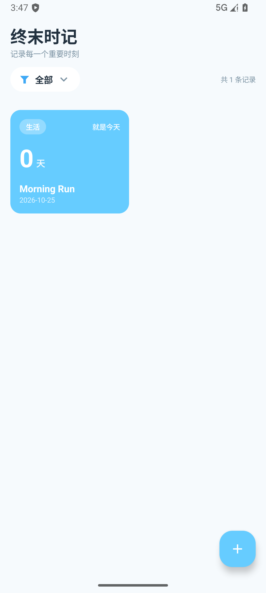
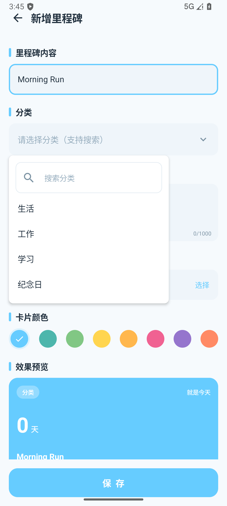
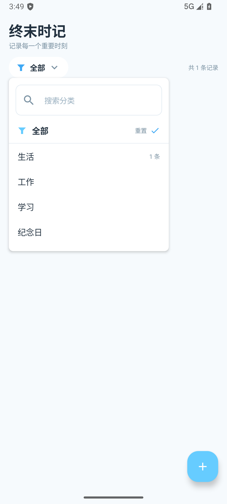
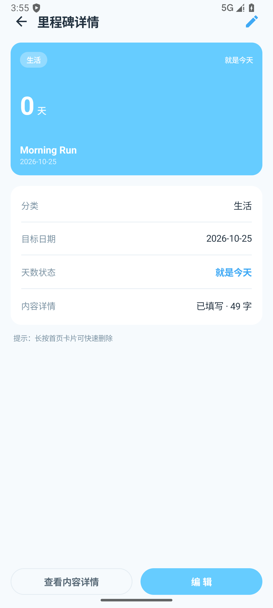
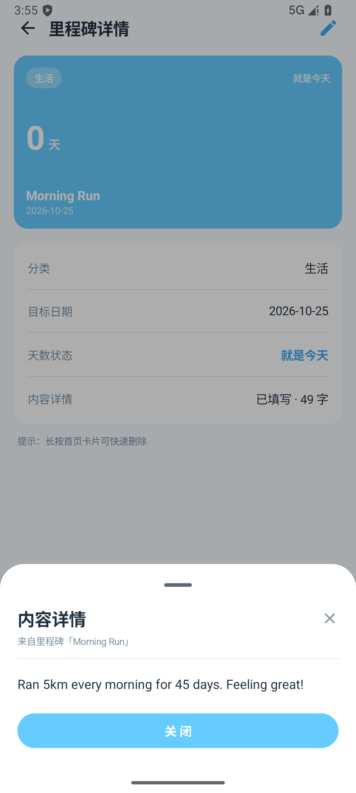
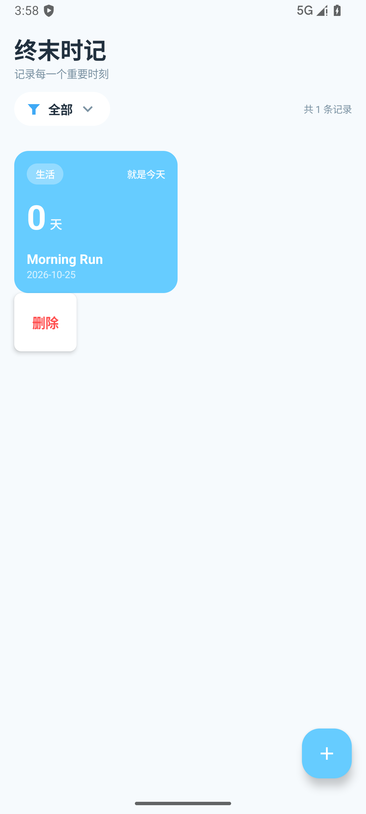
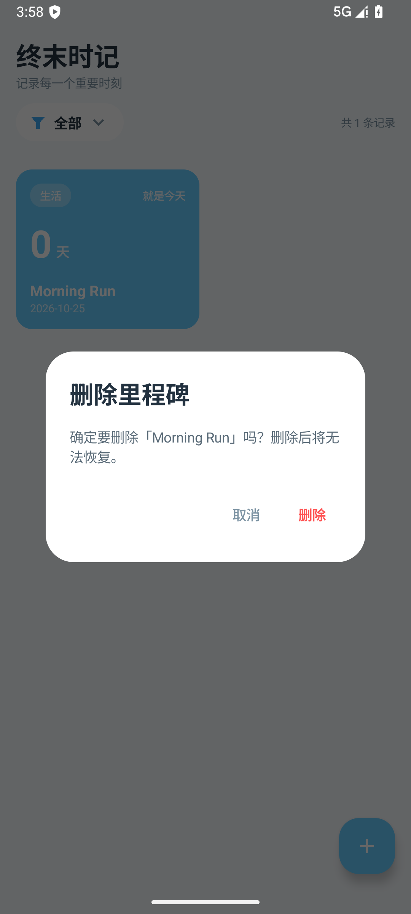
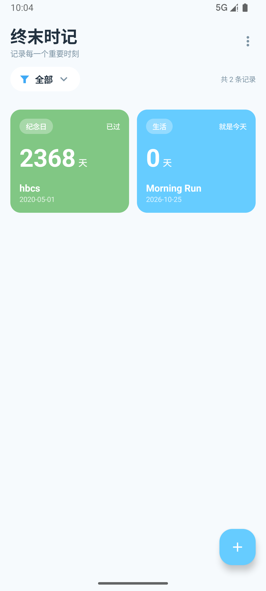

# 时记 · 开发与构建说明

> 本文档记录实际工程实现、构建环境与设计文档之间的对应关系。
> 设计依据见 `docs/01~05`，本文补充"代码怎么落地"。

## 1. 工程位置与结构

工程根目录：`D:\projects\EndFieldTime\android`

```
android/
├── settings.gradle.kts          # 仓库与模块声明
├── build.gradle.kts             # 根插件声明
├── gradle.properties            # 构建参数
├── gradle/libs.versions.toml    # 版本目录（Version Catalog）
├── gradlew / gradlew.bat        # Gradle Wrapper 9.8.2
├── local.properties             # sdk.dir（本机路径，勿提交）
└── app/
    ├── build.gradle.kts         # 应用模块配置
    └── src/
        ├── main/
        │   ├── AndroidManifest.xml
        │   ├── java/com/endfield/time/
        │   │   ├── EndFieldApp.kt          # Application + AppContainer(手动 DI)
        │   │   ├── MainActivity.kt         # 单 Activity 入口 + onResume 跨天刷新
        │   │   ├── data/
        │   │   │   ├── MilestoneRepository.kt
        │   │   │   ├── local/{MilestoneEntity,MilestoneDao,MilestoneDatabase}.kt
        │   │   │   └── prefs/SettingsStore.kt
        │   │   ├── domain/DayCounter.kt    # 天数差纯函数 + UI 模型
        │   │   └── ui/
        │   │       ├── UiEvent.kt          # 一次性事件 + ViewModel 工厂
        │   │       ├── theme/Theme.kt      # #66CCFF 色板/形状/字体
        │   │       ├── components/Common.kt# 漏斗图标、分类搜索面板、色板、仿输入框行
        │   │       ├── home/{HomeScreen,HomeViewModel,MilestoneCard}.kt
        │   │       ├── detail/{DetailScreen,DetailViewModel}.kt
        │   │       ├── edit/{EditScreen,EditViewModel}.kt
        │   │       └── nav/AppNav.kt       # 三条路由
        │   └── res/                        # strings/themes/colors/自适应图标
        └── test/java/com/endfield/time/domain/DayCounterTest.kt
```

## 2. 构建环境（实测通过）

| 组件 | 版本 | 说明 |
| --- | --- | --- |
| Android Studio | 2026.2.1（AI-262） | 已安装于 `D:\Program Files\Android\Android Studio` |
| JDK | OpenJDK 25.0.3（Studio 自带 JBR） | **无需另装 JDK**，`JAVA_HOME` 指向 `...\Android Studio\jbr` |
| Gradle | 9.8.2 | 通过 `gradlew` 固定，发行包走腾讯镜像 |
| AGP | 9.4.1 | |
| Kotlin | 内置（AGP 9 提供） | 不再单独应用 `kotlin-android` 插件 |
| 注解处理 | KSP 2.3.12 | Room 编译器 |
| Android SDK | compileSdk 36 / targetSdk 36 / minSdk 26 | platform `android-36`、build-tools `36.0.0` |
| SDK 路径 | `D:\Android\Sdk` | 由 `android` CLI 安装 |

依赖版本（`gradle/libs.versions.toml`）：Compose BOM `2025.12.01`、Room `2.8.2`、Navigation `2.9.3`、
Lifecycle `2.9.3`、Activity Compose `1.10.1`、DataStore `1.1.7`、Core KTX `1.17.0`。

## 3. AGP 9 的三个关键点（踩坑记录）

1. **内置 Kotlin**：AGP 9.0 起自带 Kotlin 编译支持，再应用 `org.jetbrains.kotlin.android`
   会直接报错要求移除。本项目已移除该插件。
2. **kapt 不再可用**：`org.jetbrains.kotlin.kapt` 与内置 Kotlin 不兼容。Room 自 2.3.0 起支持 KSP，
   因此改用 `com.google.devtools.ksp`（2.3.12）+ `ksp(room-compiler)`。
3. **不要用绕过开关**：`android.builtInKotlin=false` + `android.newDsl=false` 虽能编译，但已废弃。
   本项目已全部移除。Compose 仍需 `org.jetbrains.kotlin.plugin.compose` 插件（版本与内置 Kotlin 对齐 2.3.21）。

## 4. 常用命令

```powershell
$env:JAVA_HOME = 'D:\Program Files\Android\Android Studio\jbr'
cd D:\projects\EndFieldTime\android

.\gradlew assembleDebug          # 编译 Debug APK
.\gradlew testDebugUnitTest      # 单元测试（DayCounter 4 例）
.\gradlew installDebug           # 安装到已连接设备/模拟器
```

产物：`app\build\outputs\apk\debug\app-debug.apk`（约 12.8 MB，包名 `com.endfield.time`）。

## 5. 实现要点与设计文档的对应

| 设计条目 | 代码落点 |
| --- | --- |
| FR-001 新增 | `EditScreen`（`milestoneId == null`）→ `EditViewModel.save()` → `insert` |
| FR-003 天数计算 | `DayCounter.compute()`：已过 / 就是今天 / 还有 |
| FR-004 筛选（搜索模式） | `HomeScreen.FilterRow`：漏斗 + 当前标签 + ✕ 重置；面板复用 `CategoryMenuContent` |
| FR-005 长按删除 | `MilestoneCard.combinedClickable(onLongClick)` → 菜单 → `AlertDialog` 确认 |
| FR-011 卡片详情 | `DetailScreen`：通栏大卡片 + 信息面板 |
| FR-012 编辑 | 详情页【编辑】→ `EditScreen`（回填）→ `UPDATE` |
| FR-013 内容详情 | 详情页【查看内容详情】→ `ModalBottomSheet`，≤1000 字 |
| FR-014 分类模糊搜索 | `CategoryMenuContent`：输入即过滤、命中高亮、"＋新建分类" |
| FR-009 跨天刷新 | `MainActivity.onResume` → `AppContainer.todayFlow` → ViewModel `combine` |
| FR-010 筛选记忆 | `SettingsStore`（DataStore Preferences） |
| FR-015/016 导出导入 | `data/transfer/ExportCodec.kt`（格式编解码）、`TransferFiles.kt`（SAF 读写 + gzip）、`ui/transfer/TransferViewModel.kt`；入口在主界面右上角 `⋮` |

### 与设计文档的偏差（有意为之）

| 项 | 设计文档 | 实际实现 | 原因 |
| --- | --- | --- | --- |
| 依赖注入 | Hilt | 手动 DI（`AppContainer`） | 文档 §7 明确列为备选；单模块小工程可避免注解处理器与版本耦合 |
| 注解处理 | KSP | KSP（与文档一致） | AGP 9 下 kapt 不可用，KSP 是官方推荐 |
| 分类下拉组件 | `ExposedDropdownMenuBox` | `DropdownMenu` + 自定义搜索面板 | 需要在面板内放搜索框与计数，自定义更可控 |

## 6. 数据层设计

- 表 `milestone`：`id / content / category / targetDate(epochDay) / colorHex / detail / createdAt / sortOrder`；
- `category` 建索引，支持按分类过滤；
- DAO 全部查询返回 `Flow`，增删改落库后由 Room 自动发射最新列表驱动 UI（与流程图/时序图一致）；
- `detail` 默认空串，向后兼容"无内容详情"的记录。

## 7. 运行验证（模拟器实测）

验证环境：Android Emulator `medium_phone`（Android 16 / API 36，x86_64），APK 通过 `adb install` 安装后用
`adb shell am start` 启动，逐屏截图确认。

| 界面 | 实测截图 |
| --- | --- |
| 主界面（筛选按钮 + 卡片 + FAB + 空状态） |  |
| 新增里程碑（内容/分类下拉/内容详情/日期/8 色板/预览/保存） |  |
| 分类下拉搜索面板 | 同上（面板展开态） |
| 首页筛选面板（搜索 + 「全部」重置 + 分类计数） |  |
| 卡片详情页（大卡片 + 信息面板 + 查看内容详情/编辑） |  |
| 内容详情底部弹层（≤1000 字全文） |  |
| 长按删除菜单 |  |
| 删除二次确认对话框 |  |
| 导出/导入菜单 |  |
| 导入确认（合并/覆盖） |  |

**已实测通过的完整链路**：新增（含分类搜索选择）→ 列表展示 → 单击进详情 → 编辑回填并保存（`UPDATE`）→
内容详情弹层 → 返回 → 长按删除 → 确认删除 → 列表回到空状态；下拉与对话框底色、字数统计（49/1000）均正确。

**换机迁移也已实测**：导出 JSON（2 条记录 302 B）→ 卸载重装模拟新设备（0 条）→ 导入还原
（分类/颜色/日期/内容详情全部正确）→ 重复导入正确识别并跳过 → 压缩导出 252 B 且可正常解压。

### 修复记录（联调中发现的两个真实缺陷）

1. **分类面板导致崩溃**：`DropdownMenu` 内部放置 `LazyColumn`（SubcomposeLayout）时，Compose 请求
   intrinsic 尺寸会抛 `IllegalStateException: Asking for intrinsic measurements of SubcomposeLayout layouts is not supported`，
   应用闪退。修复：面板内改用 `Column + verticalScroll`（分类数量有限，无需懒加载）。
2. **弹层/对话框底色偏淡紫**：M3 的 `surfaceContainer*` 系列 token 默认取自淡紫调色板，与半平面白底风格不符。
   修复：在 `EndFieldTimeTheme` 中显式把 `surfaceContainerLowest/Low/High/Highest` 设为白色，并把
   `surfaceTint` 设为 `#66CCFF`。

## 8. 发版、签名与升级

### 8.1 签名配置

| 项 | 值 |
| --- | --- |
| 密钥库 | `android/keystore/endfield-release.jks`（RSA 2048，有效期 10000 天） |
| 别名 | `endfield` |
| 证书 SHA-256 | `7C:C3:87:23:F9:69:F7:19:F0:7A:A7:0C:9E:C0:28:7D:38:9B:67:8E:57:F4:AA:D7:D0:B4:40:22:12:F8:9E:11` |
| 凭据文件 | `android/keystore.properties`（`storeFile/storePassword/keyAlias/keyPassword`） |
| 版本控制 | 两者都已在 `.gitignore` 中排除，**切勿提交** |

构建：`./gradlew assembleRelease` → `app/build/outputs/apk/release/endFieldTime-<versionName>.apk`（已签名，约 8.7 MB）。产物名由 `appVersionName` 决定，改版本即自动改名。

> ⚠️ **务必离线备份密钥库和密码**。丢了就再也无法给已安装用户覆盖升级，只能让用户卸载重装（数据会丢）。

### 8.2 升级规则（Android 硬约束）

| 场景 | 结果 | 数据 |
| --- | --- | --- |
| release v1 → release v2（同签名 + versionCode 递增） | ✅ 覆盖升级 | 保留 |
| debug → release（签名不同） | ❌ `INSTALL_FAILED_UPDATE_INCOMPATIBLE` | 必须卸载，数据清空 |
| 高 versionCode → 低 versionCode | ❌ `INSTALL_FAILED_VERSION_DOWNGRADE` | — |

**发版铁律**：`versionCode` 必须严格递增。本项目已把它做成**自动推导**，见 §8.3。

### 8.3 版本规则（写进构建配置，唯一来源）

版本号固定 **两段**：`<主版本>.<次版本>`，不再增加第三段。

| 场景 | 操作 | 示例 |
| --- | --- | --- |
| 小版本迭代（加功能、修 bug） | 次版本 +1 | 1.2 → 1.3 |
| 大版本（重构、不兼容变更） | 主版本 +1，次版本归零 | 1.9 → 2.0 |

- 位置：`android/app/build.gradle.kts` 顶部 `val appVersionName = "1.2"`，**发版只改这一行**；
- `versionCode` 自动推导：`主*100 + 次`（1.2 → 102，1.3 → 103，2.0 → 200），
  因此不会忘记递增，也不会出现"装不上"的降级错误；
- 产物名随之变成 `endFieldTime-<版本名>.apk`；
- 版本名格式不符（不是两段数字）时构建会直接失败并提示，避免打出错包。

### 8.4 版本记录

| 版本 | versionCode | 内容 |
| --- | --- | --- |
| 1.0 | 1 | 首个正式版：里程碑记录、详情、编辑、导入导出 |
| 1.1 | 2 | 桌面小组件；品牌名改为「时记」 |
| 1.2 | 102 | 修复：页面标题压状态栏（statusBarsPadding/imePadding/navigationBarsPadding）；小组件移除 targetCellWidth/Height 避免部分 ROM 添加时铺满整屏；版本号规范化为两段式（原 1.1.1 并入 1.2） |

### 8.5 实测结果（模拟器验证）

| 操作 | 实际结果 |
| --- | --- |
| 装 release v1（versionCode 1），写入 2 条记录 | ✅ 正常 |
| `adb install -r` 安装 release v2（versionCode 2） | ✅ `Success`；版本变 2，**2 条记录完整保留** |
| 在 release 上安装 debug 包 | ❌ `INSTALL_FAILED_UPDATE_INCOMPATIBLE: signatures do not match` |
| 安装低 versionCode 的旧 release | ❌ `INSTALL_FAILED_VERSION_DOWNGRADE: Update version code 1 is older than current 2` |

升级后数据保留的实拍：

### 8.6 从 debug 版切到 release 版（会清数据，需迁移）

1. 在**旧（debug）版**里：`⋮` → 导出数据（JSON），文件存到「下载」；
2. 卸载旧版：`adb uninstall com.endfield.time`，或手机上长按图标卸载；
3. 安装 release 包：`adb install endFieldTime-1.1.apk`，或手机点 APK 安装；
4. 打开新版：`⋮` → 导入数据… → 选中刚才的 JSON → 合并。

之后 release → release 的每次更新，直接覆盖安装即可，无需再迁移。

## 9. 已知限制

- 未申请网络权限，纯本地运行；
- 归档包体积主要来自 Compose 运行时；
- 无桌面小组件与提醒（见设计文档 §10 规划）；
- `compileSdk` 受本机 SDK 仓库限制为 36（AndroidX 2026.09 之后的版本要求 37，故依赖停留在 2025.12 一组）。
