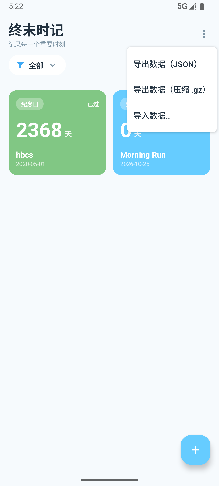
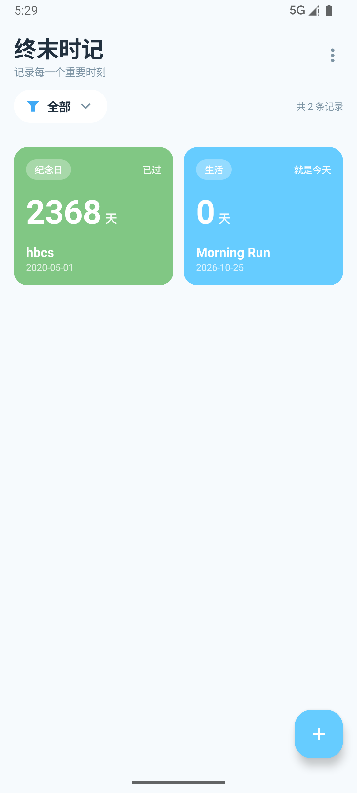

# 时记 · 数据导入导出设计

| 项目 | 内容 |
| --- | --- |
| 目标 | 更换设备时迁移全部里程碑数据（含内容详情） |
| 格式版本 | v1（`format: endfield-time-export`） |
| 实现位置 | `data/transfer/ExportCodec.kt`、`TransferFiles.kt`、`ui/transfer/TransferViewModel.kt` |
| 实测数据 | 2 条记录（含 49 字详情）→ **302 B**；压缩后 **252 B** |

---

## 1. 设计目标与约束

| 目标 | 说明 |
| --- | --- |
| 完整 | 内容、分类、目标日期、卡片颜色、内容详情（≤1000 字）、创建时间全部还原 |
| 够小 | 体积主要由详情文本决定，格式本身的开销要压到最低 |
| 可读可查 | 出问题能直接打开看，不必专用工具；便于用户自查/手工修复 |
| 免权限 | 不申请存储权限，使用系统文件选择器（SAF） |
| 可演进 | 未来加字段（提醒、置顶）不破坏旧文件 |
| 安全 | 不执行外部内容；对脏数据、超大文件做防护 |

## 2. 格式选型对比

| 方案 | 优点 | 缺点 | 结论 |
| --- | --- | --- | --- |
| A. 全字段 JSON | 最易读，字段自解释 | 键名重复、日期/颜色写成字符串，体积最大 | 参考基线 |
| B. **紧凑键 JSON**（选中） | 可读性尚可（配本文档即懂），体积显著小于 A，无第三方依赖 | 需要文档说明键含义 | ✅ **默认格式** |
| C. CSV | 体积与 B 接近 | 详情含逗号/换行/引号需转义，嵌套与版本演进差，容易出现半行脏数据 | ❌ |
| D. gzip 压缩的 JSON | 再省 45%~58% | 不可直接阅读；小文件因头部开销反而收益低 | ✅ **可选导出** |
| E. 二进制（protobuf/自定义） | 体积最小、解析快 | 需要 schema 与依赖，无法人工排查，对这点数据量属于过度设计 | ❌ |

**结论：默认导出 B（紧凑 JSON），并提供 D（同结构 JSON 的 gzip 包装，扩展名 `.json.gz`）。**
导入端**不依赖扩展名**，按文件头 `1F 8B` 自动识别是否 gzip。

## 3. 体积实测

测算脚本：`tools/measure_export_size.py`（生成 60% 记录带 40~300 字详情的模拟数据，详情为高熵随机汉字，属**保守**估计）。

| 记录数 | A 全字段 JSON | B 紧凑 JSON | B + gzip | CSV | B 相对 A 节省 | gzip 相对 A 节省 |
| --- | --- | --- | --- | --- | --- | --- |
| 10 | 6,031 B | 5,236 B | 3,380 B | 5,073 B | 13.2% | 44.0% |
| 50 | 23,027 B | 18,529 B | 10,548 B | 18,229 B | 19.5% | 54.2% |
| 200 | 88,459 B | 69,972 B | 37,430 B | 69,160 B | 20.9% | 57.7% |
| 1000 | 466,254 B | 373,032 B | 195,990 B | 369,354 B | 20.0% | 58.0% |

**单条成本**：不含详情约 **62 B/条**；带 40~300 字详情约 **350~376 B/条**。

实机验证（2 条记录，其中 1 条含 49 字英文详情）：明文 **302 B**、gzip **252 B**。

> 说明：gzip 对小文件不划算（两个 gzip 头约 20 B，且小文本压缩率低）。经验阈值：**明文超过约 4 KB（≈15 条带详情记录）时压缩才明显省空间**；日常几十条记录两种格式都只有几十 KB，可任意选择。

## 4. v1 格式规范

```json
{"format":"endfield-time-export","version":1,"exportedAt":1792905878,"appVersion":"1.0",
 "categories":["生活","纪念日"],
 "milestones":[
   {"c":"Morning Run","k":0,"d":20751,"h":0,"a":1792899778,"t":"Ran 5km every morning for 45 days. Feeling great!"},
   {"c":"hbcs","k":1,"d":18383,"h":2,"a":1792903730}
 ]}
```

### 4.1 顶层字段

| 键 | 类型 | 必填 | 说明 |
| --- | --- | --- | --- |
| `format` | string | ✅ | 固定 `endfield-time-export`，用于识别文件来源 |
| `version` | int | ✅ | 格式版本，当前 `1` |
| `exportedAt` | int | — | 导出时间（Unix 秒） |
| `appVersion` | string | — | 导出时的应用版本，便于排障 |
| `categories` | string[] | — | **分类字典**，记录内用下标引用，避免重复存分类名 |
| `milestones` | object[] | ✅ | 记录数组 |

### 4.2 记录字段（`milestones[]`）

| 键 | 类型 | 必填 | 说明 |
| --- | --- | --- | --- |
| `c` | string | ✅ | 内容（≤50 字） |
| `k` | int \| string | ✅ | 分类：字典下标；也接受直接写分类名（兼容手工编辑/旧数据） |
| `d` | int | ✅ | 目标日期，**epochDay**（如 20751 = 2026-10-25） |
| `h` | int \| string | — | 卡片颜色：8 色板下标（0~7）；非预设色写 `#RRGGBB`。缺省取 0 |
| `a` | int | — | 创建时间（Unix **秒**，导入时 ×1000 转毫秒）。缺省取导入时刻 |
| `t` | string | — | 内容详情（≤1000 字）。**为空则整个键省略** |
| `s` | int | — | 排序值。**为 0 则省略** |
| ~~`id`~~ | — | — | **不导出**：主键是设备本地值，导入时重新分配，避免冲突 |

### 4.3 空间优化清单（逐项）

| 手段 | 相对方案 A 的效果 |
| --- | --- |
| 紧凑键（`c/k/d/h/a/t/s`） | 省 ~10~14%（键名 3~4 倍长 → 1 字符） |
| 日期用 epochDay 整数 | 每条省 5~6 B（`"2026-10-25"` → `20751`） |
| 分类用字典下标 | 每条省 2~8 B，且分类名越长收益越大 |
| 颜色用色板下标 | 每条省 6 B（`"#66CCFF"` → `0`） |
| 时间戳降为秒 | 每条省 3 B |
| 空详情省略键 | 无详情记录直接少 4 B；详情为空是常见情况 |
| 默认值不写（`s=0`、`h=0` 可省） | 每条再省几个字节 |
| 可选 gzip | 明文 >4 KB 时再省 45%~58% |

## 5. 导入流程与冲突处理

```
选择文件(SAF) → 读取(按文件头识别 gzip) → 解码校验 → 预览对话框 → 用户选择「合并 / 覆盖」→ 写库 → Toast 汇总
```

| 环节 | 处理 |
| --- | --- |
| 格式校验 | `format` 不匹配 → 提示"这不是「时记」的导出文件" |
| 版本校验 | `version > 1` → 提示"文件版本过高，请先升级应用"；低版本按兼容规则读取 |
| 脏数据 | 内容为空、缺日期、日期越界（1900~2200）→ 跳过并计数，最后汇总"忽略 N 条无效数据" |
| 超长字段 | 内容截断 50 字、分类 10 字、详情 1000 字，不因个别字段失败 |
| **去重** | 去重键 = **内容 + 分类 + 目标日期**（`Repository.identityKey`） |
| 合并模式 | 只插入本地不存在的记录，重复跳过；不修改已有记录 |
| 覆盖模式 | 先清空本地全表再导入（有二次确认文案） |
| 主键 | 导入记录 `id = 0` 交由 Room 自增，避免与本地记录主键碰撞 |
| 文件大小 | 上限 32 MB，超出直接拒绝（防御异常/恶意文件） |

## 6. 安全与隐私

- 使用 **SAF**（`ACTION_CREATE_DOCUMENT` / `ACTION_OPEN_DOCUMENT`），**不申请任何存储权限**；
- 解析使用 `org.json`，只做数据读取，**不执行任何脚本/反射/外部代码**；
- 所有字段做类型与长度校验，非法类型走默认值或跳过；
- 文件仅由用户选择的路径读写，应用不主动扫描存储；
- 导出内容为用户本人数据，文件落在用户指定位置，由用户自行保管。

## 7. 交互设计

| 界面 | 说明 | 截图 |
| --- | --- | --- |
| 更多菜单 | 主界面右上角 `⋮` → 导出数据（JSON）/ 导出数据（压缩 .gz）/ 导入数据… |  |
| 导入确认 | 显示解析条数、重复条数、无效条数；三个动作：取消 / 覆盖 / 合并 |  |
| 导入结果 | 列表自动刷新（Flow 驱动），Toast 汇总"导入 N 条，跳过 M 条重复" |  |

导出文件名：`时记-yyyyMMdd-HHmm.json`（压缩版追加 `.gz`），由系统保存面板允许用户改名与选择目录。

## 8. 版本演进规则

- **新增可选字段**：直接加键，`version` 不变（旧版本应用会把未知键忽略）；
- **修改字段含义或必填性**：`version` 递增，导入端按版本分支处理；
- **删除字段**：保留 `version` 兼容读取逻辑至少一个大版本；
- 读取端策略：`version > 当前支持` 一律拒绝并提示升级，绝不"猜着读"。

## 9. 实测记录（换机验证）

| 步骤 | 结果 |
| --- | --- |
| 设备 A 有 2 条记录 → 导出 JSON | `时记-20261025-0523.json`，**302 B**；内容含分类字典、颜色下标、epochDay、1 条含详情 1 条无详情（详情键省略） |
| 卸载应用（模拟新设备）再安装 | 列表为空、共 0 条记录 ✅ |
| 导入该文件 → 合并 | 恢复 2 条；分类（生活/纪念日）、颜色、日期（含"已过 2368 天"）全部正确 ✅ |
| 打开详情页 | 内容详情显示"已填写 · 49 字"，文本完整 ✅ |
| 重复导入同一文件 | 提示"其中 2 条与本机已有记录重复"，合并后仍为 2 条 ✅ |
| 导出压缩版 | `…json.gz` 252 B，文件头 `1F 8B`，解压后与明文完全一致 ✅ |
