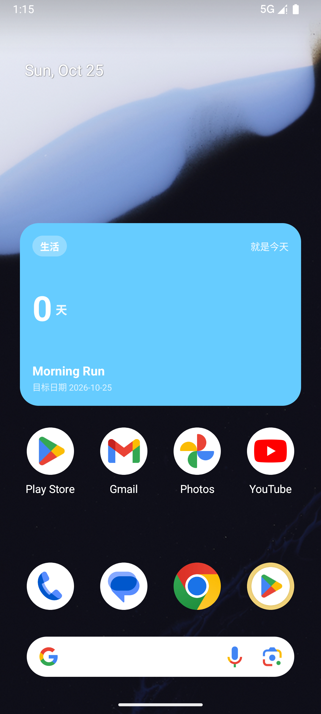
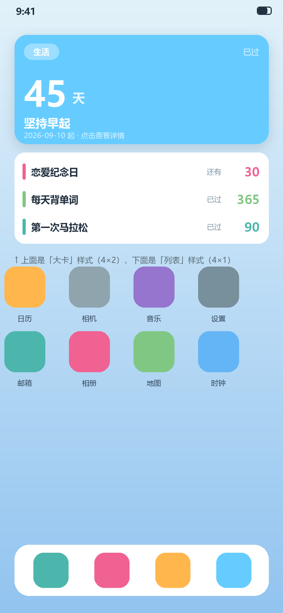

# 时记 · 桌面小组件设计

| 项目 | 内容 |
| --- | --- |
| 版本 | v1.1（versionCode 2） |
| 形态 | 单条里程碑大卡（默认 4×2，可横向/纵向缩放） |
| 实现 | 原生 AppWidget + RemoteViews（未引入 Glance） |
| 代码 | `widget/MilestoneWidgetProvider.kt`、`WidgetRenderer.kt`、`WidgetUpdater.kt`、`WidgetBindings.kt`、`WidgetConfigActivity.kt` |

---

## 1. 目标与形态

在桌面上常驻一块只读卡片，**不打开应用就能看到某个里程碑距今天的天数**。

| 元素 | 说明 |
| --- | --- |
| 分类胶囊 | 白 30% 底 + 白色文字 |
| 天数标签 | 「已过 / 还有 / 就是今天」 |
| 天数大数字 | 44sp 加粗 + 「天」 |
| 内容标题 | 单行，超长省略 |
| 目标日期 | 小字次要信息 |
| 卡片底色 | 用户为该里程碑选的颜色（分类型颜色以外的自定义色也支持） |

实拍：
设计稿与两种形态对比：

## 2. 交互

| 操作 | 行为 |
| --- | --- |
| 点按 | 打开「时记」 |
| 添加时 | 直接进入配置页选择要显示的里程碑 |
| 长按 → 重新配置 | 重新进入配置页改绑另一条（部分启动器需先点「编辑」） |
| 长按 → 移除 | 清除该实例的绑定关系（`onDeleted`） |
| 拖拽边缘 | 缩放（`resizeMode="horizontal|vertical"`） |

## 3. 数据绑定

- 每个小组件实例有独立 `appWidgetId`，绑定关系存 SharedPreferences：
  `widget_bindings` → `widget_<appWidgetId>` → `milestoneId`；
- 不存快照，每次刷新都按 id 查库，**保证数据永远是最新的**；
- 记录被删除后，绑定仍在但查不到数据 → 显示占位文案「点按选择里程碑」。

## 4. 刷新策略

| 触发点 | 何时 | 说明 |
| --- | --- | --- |
| 系统周期 | 每 30 分钟 | `updatePeriodMillis="1800000"`（系统允许的最小粒度） |
| **数据变更** | 增/改/删/导入后立即 | Repository 写操作回调 `onDataChanged` → `refreshAll()` |
| 应用回到前台 | `onResume` | 跨天或系统时间被改后立即纠正 |
| 重新配置 / 缩放 | 即时 | `onUpdate` / `onAppWidgetOptionsChanged` |

> 跨天准确性：系统周期最小 30 分钟，因此午夜后最多延迟 30 分钟更新；打开应用会立刻刷新。
> 如后续要求「整点必刷」，再引入 `AlarmManager.setExactAndAllowWhileIdle`（需处理精确闹钟权限）。

## 5. 技术选型：RemoteViews 而非 Glance

| 维度 | RemoteViews（选中） | Jetpack Glance |
| --- | --- | --- |
| 依赖 | 0 新增 | 新增 Glance，且与 Compose 版本强耦合 |
| 与本项目契合 | 布局简单（一个卡片） | 适合复杂/多形态组件 |
| 版本风险 | 无 | 本项目已因 AGP9/Kotlin/Compose 版本折腾过，避免再引入耦合 |
| 开发效率 | XML + 代码，样板多 | Compose 写法更顺手 |

结论：单卡片场景用 RemoteViews 更稳；若将来要做多形态（列表/日历）再评估 Glance。

## 6. 踩坑记录（RemoteViews 限制）

1. **`Space` / `View` 不允许**：RemoteViews 只接受白名单控件，`android.widget.Space` 与 `android.view.View`
   都会抛 `InflateException: Class not allowed to be inflated`。用**空 LinearLayout** 充当占位/弹簧。
2. **静态预览不执行代码**：`previewLayout` 只渲染 XML 布局，`setColorFilter` 不会跑。因此：
   - 背景 drawable 默认色设为品牌蓝 `#66CCFF`（否则白底 + 白字 = 预览一片空白）；
   - 各文本控件写好示例文案（生活 / 已过 / 45 / 坚持早起），真实数据随后覆盖。
3. **动态底色要保留圆角**：用 `ImageView + setColorFilter(color)`，而不是 `setBackgroundColor`（后者会把圆角 shape 整个替换掉）。

## 7. 已知限制

- 单实例只显示一条里程碑（列表样式未做）；
- 跨天刷新精度 30 分钟（见 §4）；
- 点按只打开应用首页，未做「直达该里程碑详情页」的 deep link（v1.2 可加）。

## 8. 实测记录（模拟器）

| 步骤 | 结果 |
| --- | --- |
| 长按桌面 → Widgets → 时记 | 预览卡正确渲染（分类/天数/标题/日期/底色） ✅ |
| 拖到桌面 | 弹出配置页，列出全部记录（带颜色点与天数） ✅ |
| 无数据时打开配置页 | 显示空状态与「打开时记」入口 ✅ |
| 选择「Morning Run」 | 桌面出现卡片：生活 / 就是今天 / 0 天 / Morning Run / 2026-10-25 ✅ |
| 点按小组件 | 打开应用（`topResumedActivity=com.endfield.time/.MainActivity`） ✅ |
